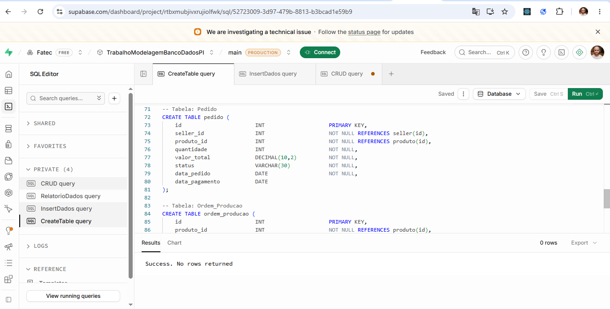
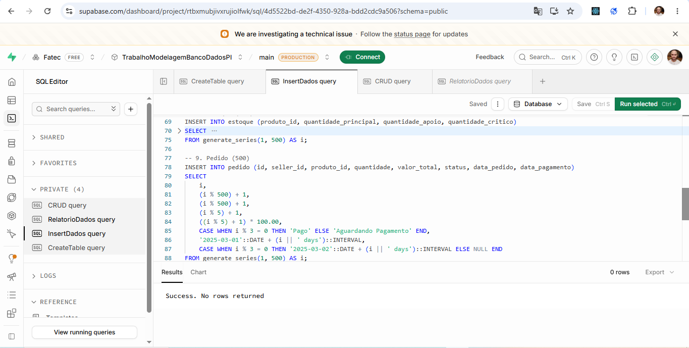

# Trabalho Final - Modelagem de Banco de Dados

**Projeto Interdisciplinar: Eliot 1.0 - Sistema de Gestão de Estoque para Dropshipping**

**Aluno:** Nelson Marques Sampaio (e equipe)
**Curso:** Desenvolvimento de Software Multiplataforma (DSM) - Fatec Franca
**Disciplina:** Modelagem de Banco de Dados
**Professor:** [Nome do Professor]

---

## 1. Cenário

O **Eliot 1.0** é um ecossistema ERP Multilojas desenvolvido como parte do Projeto Interdisciplinar (PI) do curso de DSM. Ele resolve o problema crítico de **"Venda Fantasma"** no modelo de dropshipping, onde múltiplos vendedores (Sellers) anunciam o mesmo produto que já não existe no estoque físico do Fornecedor. 

O sistema conecta Fornecedores e Sellers em tempo real, controlando o **Estoque Triplo** (Principal, Apoio e Crítico), gerenciando o fluxo de pagamento via PIX, emitindo etiquetas de envio e controlando as **Ordens de Produção (OP)** no Kanban da fábrica.

**Entidades Principais:** Seller, Marketplace, Fornecedor, Produto, Estoque, Pedido, Ordem de Produção, entre outras.

---

## 2. Modelagem Conceitual (DER)

O Diagrama Entidade-Relacionamento (DER) foi construído seguindo as regras do Modelo Entidade-Relacionamento (MER), contemplando:
- **Atributos Simples:** Nome, Email, SKU, Preço de Custo.
- **Atributos Compostos:** Endereço do Seller (Rua + Número).
- **Atributos Multivalorados:** Telefones do Seller (tabela separada).
- **Atributos Derivados:** Tempo de Processamento do Pedido (Data de Pagamento - Data do Pedido).
- **Relacionamentos:**
  - **1:1:** Seller ↔ Carteirinha_Seller.
  - **1:N:** Fornecedor → Produto; Seller → Pedido.
  - **N:N:** Seller ↔ Marketplace (via Seller_Marketplace).


---

## 3. Modelagem Lógica Relacional

A transformação do DER para o modelo lógico resultou nas seguintes tabelas:

| Tabela                  | Chave Primária (PK)          | Chaves Estrangeiras (FK)     | Atributos Principais          |
| :---                    | :---                         | :---                         | :---                          |
| **fornecedor**          | `id`                         | -                            | nome_empresa, cnpj, email     |
| **seller**              | `id`                         | -                            | nome_loja, email, cnpj, endereco_rua, endereco_numero |
| **marketplace**         | `id`                         | -                            | nome, taxa_comissao           |
| **carteirinha_seller**  | `id`                         | `seller_id`                  | data_emissao, codigo          |
| **telefone_seller**     | `id`                         | `seller_id`                  | telefone                      |
| **seller_marketplace**  | `seller_id`, `marketplace_id`| `seller_id`, `marketplace_id`| token_api, status_conexao            |
| **produto**             | `id`                         | `fornecedor_id`              | nome, sku, preco_custo, descricao                 |
| **estoque**             | `produto_id`                 | `produto_id`                 | quantidade_principal, quantidade_apoio, quantidade_critico                     |
| **pedido**              | `id`                         | `seller_id`, `produto_id`    | quantidade, valor_total, status, data_pedido, data_pagamento                      |
| **ordem_producao**      | `id`                         | `produto_id`                 | quantidade, setor_atual, urgente, data_criacao     |

---

## 4. Modelagem Física (Implementação no Supabase)

As tabelas foram implementadas no Supabase (PostgreSQL) garantindo a integridade referencial com o uso de `PRIMARY KEY` e `FOREIGN KEY`.

### Scripts SQL de Criação

```sql
-- 1. Fornecedor
CREATE TABLE fornecedor (
    id INT PRIMARY KEY,
    nome_empresa VARCHAR(100) NOT NULL,
    cnpj VARCHAR(18) NOT NULL UNIQUE,
    email VARCHAR(100) NOT NULL UNIQUE,
    telefone VARCHAR(20) NOT NULL
);

-- 2. Seller
CREATE TABLE seller (
    id INT PRIMARY KEY,
    nome_loja VARCHAR(100) NOT NULL,
    email VARCHAR(100) NOT NULL UNIQUE,
    cnpj VARCHAR(18) NOT NULL UNIQUE,
    endereco_rua VARCHAR(100) NOT NULL,
    endereco_numero INT NOT NULL,
    data_cadastro DATE NOT NULL
);

-- 3. Marketplace
CREATE TABLE marketplace (
    id INT PRIMARY KEY,
    nome VARCHAR(50) NOT NULL UNIQUE,
    taxa_comissao DECIMAL(5,2) NOT NULL
);

-- 4. Carteirinha_Seller
CREATE TABLE carteirinha_seller (
    id INT PRIMARY KEY,
    seller_id INT NOT NULL UNIQUE REFERENCES seller(id),
    data_emissao DATE NOT NULL,
    codigo VARCHAR(20) NOT NULL UNIQUE
);

-- 5. Telefone_Seller
CREATE TABLE telefone_seller (
    id INT PRIMARY KEY,
    seller_id INT NOT NULL REFERENCES seller(id),
    telefone VARCHAR(20) NOT NULL
);

-- 6. Seller_Marketplace
CREATE TABLE seller_marketplace (
    seller_id INT NOT NULL REFERENCES seller(id),
    marketplace_id INT NOT NULL REFERENCES marketplace(id),
    token_api VARCHAR(100) NOT NULL,
    status_conexao VARCHAR(20) NOT NULL,
    PRIMARY KEY (seller_id, marketplace_id)
);

-- 7. Produto
CREATE TABLE produto (
    id INT PRIMARY KEY,
    fornecedor_id INT NOT NULL REFERENCES fornecedor(id),
    nome VARCHAR(100) NOT NULL,
    sku VARCHAR(50) NOT NULL UNIQUE,
    preco_custo DECIMAL(10,2) NOT NULL,
    descricao TEXT
);

-- 8. Estoque
CREATE TABLE estoque (
    produto_id INT PRIMARY KEY REFERENCES produto(id),
    quantidade_principal INT NOT NULL DEFAULT 0,
    quantidade_apoio INT NOT NULL DEFAULT 0,
    quantidade_critico INT NOT NULL DEFAULT 0
);

-- 9. Pedido
CREATE TABLE pedido (
    id INT PRIMARY KEY,
    seller_id INT NOT NULL REFERENCES seller(id),
    produto_id INT NOT NULL REFERENCES produto(id),
    quantidade INT NOT NULL,
    valor_total DECIMAL(10,2) NOT NULL,
    status VARCHAR(30) NOT NULL,
    data_pedido DATE NOT NULL,
    data_pagamento DATE
);

-- 10. Ordem_Producao
CREATE TABLE ordem_producao (
    id INT PRIMARY KEY,
    produto_id INT NOT NULL REFERENCES produto(id),
    quantidade INT NOT NULL,
    setor_atual VARCHAR(30) NOT NULL,
    urgente BOOLEAN NOT NULL DEFAULT FALSE,
    data_criacao DATE NOT NULL
);

```
---

### Prints da Estrutura no Supabase

**1. Criação das Tabelas e Relações:**
*Tela mostrando o SQL Editor do Supabase com o script de criação das 10 tabelas executado com sucesso.*



**2. Lista das Tabelas Criadas:**
*Visualização das tabelas criadas para cumprir com a demanda inicial do Projeto Interdiciplinar (PI).*


**3. Inserção de Dados Fictícios:**
*Script SQL de inserção em massa (500 registros por tabela) sendo executado no SQL Editor.*



**4. Tabela de Pedidos:**
*Visualização da tabela `pedido` no Table Editor, contendo 500 registros com status "Pago" e "Aguardando Pagamento".*


**5. Tabela de Produtos:**
*Visualização da tabela `produto` no Table Editor, com os SKUs e preços de custo cadastrados.*


**6. Tabela de Estoque Triplo:**
*Estrutura da tabela `estoque`, demonstrando os três níveis: Principal, Apoio e Crítico.*


---

## 5. Dados

Para simular um ambiente real de operação, o banco de dados foi populado com **500 registros em cada uma das 10 tabelas** (totalizando 5.000 registros). 

Para garantir agilidade e consistência, utilizamos a função nativa do PostgreSQL `generate_series` nos scripts de inserção. Isso permitiu criar dados fictícios, mas seguindo as regras de negócio do Eliot 1.0:

- **Pedidos:** 1/3 dos pedidos foram marcados como "Pago" (com `data_pagamento` preenchida) e 2/3 como "Aguardando Pagamento" (`data_pagamento` nula).
- **Estoque Triplo:** As quantidades de Estoque Principal, Apoio e Crítico foram geradas com valores proporcionais para simular produtos em diferentes níveis de alerta.
- **Ordens de Produção:** 20% das ordens foram marcadas como urgentes (`urgente = TRUE`) para simular os gargalos de produção.
- **Datas:** As datas de cadastro, pedidos e produções foram distribuídas ao longo do ano de 2025 para permitir a criação de relatórios temporais.

### Prints dos Dados Inseridos

**Exemplo de Dados na Tabela de Pedidos:**
*Visualização da tabela `pedido` mostrando a consistência entre o status e a data de pagamento.*


**Exemplo de Dados na Tabela de Produtos:**
*Visualização da tabela `produto` com 500 registros de SKUs e preços.*


*(Os scripts SQL completos de inserção estão disponíveis na pasta `scripts/` do repositório).*